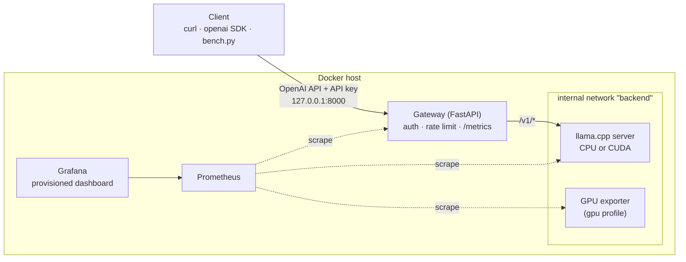
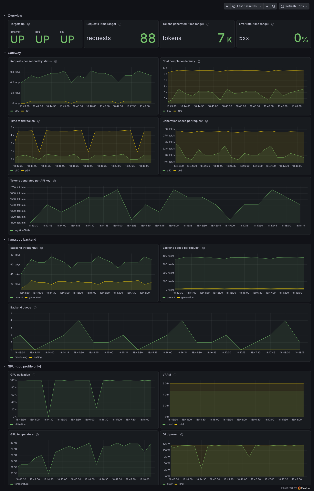
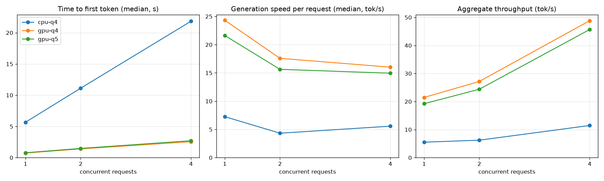

# selfhosted-llm-gateway

[](https://github.com/MelihTuerk/selfhosted-llm-gateway/actions/workflows/ci.yml)

A self-hosted LLM inference stack you start with one `docker compose up`:
[llama.cpp](https://github.com/ggml-org/llama.cpp) behind an OpenAI-compatible gateway
with API-key auth, rate limiting and Prometheus/Grafana monitoring. Runs on a plain CPU
or on an NVIDIA GPU, including older Pascal cards like the GTX 1060.

The gateway, the benchmark tool, the monitoring setup and the CI are written for this
project; llama.cpp, Prometheus, Grafana and the GPU exporter are off-the-shelf components.

## Architecture



- **llama.cpp has no published port.** It sits on an internal Docker network, so the
  gateway is the only way in and auth cannot be bypassed.
- **The gateway is a transparent proxy.** Requests and responses (including server-sent
  events) are streamed through unchanged; it adds auth, a per-key rate limit and metrics.
- **Monitoring is code.** Prometheus scrape config, the Grafana data source and the
  dashboard are provisioned from this repository; nothing is clicked together by hand.
- All host ports (gateway, Grafana, Prometheus) are bound to `127.0.0.1` only.

## Features

- OpenAI-compatible `/v1/models` and `/v1/chat/completions`, including streaming;
  the official `openai` Python SDK works unmodified with `base_url`
- API keys via `Authorization: Bearer`, compared in constant time; fails closed if no
  keys are configured
- Rate limit per key (token bucket), `429` with `Retry-After`
- Clean OpenAI-style errors when the backend is down (`502`) or times out (`504`)
- Prometheus metrics: requests by status, latency histogram, time to first token,
  tokens/s, tokens per key (keys appear only as a short hash, never in plain text)
- Grafana dashboard: gateway traffic and latency, llama.cpp throughput and queue,
  GPU utilisation, VRAM, temperature and power
- Two compose profiles: `cpu` (any machine, CI) and `gpu` (NVIDIA, CUDA)
- Benchmark CLI: time to first token, generation speed and throughput at 1/2/4 parallel
  requests, CSV + chart
- CI on GitHub Actions: ruff, pytest, compose validation for both profiles, image build,
  and an end-to-end test that starts the CPU stack and talks to it with the `openai` SDK

## Quickstart (CPU)

Requirements: Docker with Compose v2.

```bash
cp .env.example .env                 # then set GATEWAY_API_KEYS and GRAFANA_ADMIN_PASSWORD
scripts/download-model.sh            # Qwen2.5-0.5B-Instruct Q4_K_M, ~490 MB
docker compose --profile cpu up -d --build --wait

KEY=<one of the keys from GATEWAY_API_KEYS>
curl -N http://127.0.0.1:8000/v1/chat/completions \
  -H "Authorization: Bearer $KEY" \
  -H 'Content-Type: application/json' \
  -d '{"messages":[{"role":"user","content":"Hello!"}],"stream":true}'
```

- Grafana: http://127.0.0.1:3000 (user `admin`, password from `.env`)
- Prometheus: http://127.0.0.1:9090
- Smoke test with the official SDK: `GATEWAY_API_KEY=$KEY uv run scripts/sdk_smoke_test.py`

## Quickstart (GPU)

Requirements: an NVIDIA GPU with a working driver (`nvidia-smi`) and the
[NVIDIA Container Toolkit](https://docs.nvidia.com/datacenter/cloud-native/container-toolkit/latest/install-guide.html)
configured for Docker. Check with
`docker run --rm --gpus all nvidia/cuda:12.9.1-base-ubuntu24.04 nvidia-smi`.

```bash
scripts/download-model.sh qwen2.5-7b-q4   # Qwen2.5-7B-Instruct Q4_K_M, ~4.7 GB, fits a 6 GB GPU
# in .env:
#   MODEL_FILE=qwen2.5-7b-instruct-q4_k_m-00001-of-00002.gguf
#   MODEL_ALIAS=qwen2.5-7b-instruct
docker compose --profile gpu up -d --build --wait
```

The `gpu` profile swaps the llama.cpp service for the CUDA image with all layers on the
GPU (`GPU_LAYERS=99`) and adds the GPU exporter. Gateway, Prometheus and Grafana are the
same in both profiles.

## Dashboard

The provisioned Grafana dashboard during a benchmark on the GTX 1060 (`gpu` profile):
gateway traffic and latency, llama.cpp throughput and queue, GPU utilisation, VRAM,
temperature and power. The `401` line comes from requests with a wrong API key.



## Configuration

Everything is set in `.env` (see [`.env.example`](.env.example) for all options):

| Variable | Default | Meaning |
|---|---|---|
| `GATEWAY_API_KEYS` | – (required) | Accepted API keys, comma-separated |
| `GATEWAY_RATE_LIMIT_PER_MINUTE` / `_BURST` | `60` / `10` | Rate limit per key; `0` disables it |
| `MODEL_FILE` / `MODEL_ALIAS` | Qwen2.5-0.5B | GGUF file in `models/`, name shown by `/v1/models` |
| `CTX_SIZE` / `PARALLEL` | `4096` / `2` | Total context, shared by `PARALLEL` request slots |
| `GPU_LAYERS` | `99` | Layers offloaded to the GPU (`gpu` profile) |
| `LLAMA_IMAGE` / `LLAMA_GPU_IMAGE` | build `b12627` | llama.cpp images, pinned to one build |
| `GATEWAY_PORT`, `GRAFANA_PORT`, `PROMETHEUS_PORT` | `8000`, `3000`, `9090` | Host ports (on `127.0.0.1`) |

## Benchmarks

Measured with [`bench/bench.py`](bench/bench.py) through the gateway, on one desktop PC
(Intel Core i5-8600K, 6 cores · 16 GB RAM · NVIDIA GTX 1060 6 GB, driver 580 · Ubuntu 26.04).
Model: Qwen2.5-7B-Instruct (official GGUF), llama.cpp build `b12627` for CPU and GPU.
Each run: 8 streaming requests per concurrency level, ~290 prompt tokens, exactly 128
generated tokens, `CTX_SIZE=4096`, `PARALLEL=4`, one warm-up request first.
Single runs on one machine, not averaged over repeated runs.



| Run | Quantisation | Parallel | TTFT median | Tokens/s per request | Tokens/s total | VRAM used |
|---|---|---:|---:|---:|---:|---:|
| CPU (i5-8600K) | Q4_K_M | 1 | 5.67 s | 7.2 | 5.5 | – |
| | | 4 | 21.85 s | 5.6 | 11.5 | |
| GPU (GTX 1060) | Q4_K_M | 1 | 0.74 s | 24.3 | 21.5 | 4.8 GB |
| | | 4 | 2.56 s | 16.0 | 48.8 | |
| GPU (GTX 1060) | Q5_K_M | 1 | 0.78 s | 21.6 | 19.2 | 5.4 GB |
| | | 4 | 2.71 s | 14.9 | 45.7 | |

All levels (1/2/4), p95 values and the raw per-request data are in
[`bench/results/`](bench/results/). *Tokens/s per request* counts from the first token to
the last; *tokens/s total* is all generated tokens of a level divided by its wall-clock
time, so it includes prompt processing. VRAM is the total on the card, including about
0.2 GB used by the desktop.

What the numbers show:

- **The GPU is 3–8× faster than the CPU** for the same model: 3.4× in generation speed,
  7.7× in time to first token, 4.2× in total throughput at 4 parallel requests. Prompt
  processing is compute-bound and profits most from the GPU.
- **Parallel requests trade latency for throughput.** On the GPU, 4 parallel requests
  double the total throughput (21.5 → 48.8 tokens/s), while each request gets slower and
  waits longer for its first token.
- **Q5_K_M costs about 11 % speed and 0.6 GB VRAM over Q4_K_M.** Generating a token reads
  all weights from memory, so the larger file is slower. With the desktop running, Q5_K_M
  just fits into 6 GB.
- On the CPU, generation speed per request is lower at 2 than at 4 parallel requests.
  While a request generates, llama.cpp also processes the prompts of newly arriving
  requests in the same steps, and on a CPU those prompt batches are slow. How much a
  request is slowed depends on when other requests arrive, so treat single CPU values
  with care.

To reproduce: start the stack, then
`GATEWAY_API_KEY=<key> uv run bench/bench.py run --label <name> --hardware "<gpu or cpu>"`
for each configuration, and `uv run bench/bench.py plot`.

## Development

```bash
cd gateway
uv run pytest -q                       # unit tests with a mocked backend (respx)
uv run ruff check . && uv run ruff format --check .
```

For direct access to llama.cpp while debugging, add the dev override, which publishes
it on `127.0.0.1:8080`:
`docker compose -f compose.yaml -f compose.dev.yaml --profile cpu up -d`

```
gateway/      FastAPI gateway (proxy, auth, rate limit, metrics) + tests
bench/        benchmark CLI and results
monitoring/   Prometheus config, Grafana provisioning and dashboard
scripts/      model download (with SHA-256 check), OpenAI SDK smoke test
compose.yaml  the stack, profiles cpu and gpu
```

## Lessons learned

- **Pascal GPUs are on borrowed time.** NVIDIA's 580 driver branch is the last one with
  Pascal support, and CUDA 13 can no longer compile for compute capability 6.1. The
  official llama.cpp CUDA image still works because it is built with CUDA 12.8 and ships
  PTX for older architectures; the driver compiles it on first use. That makes the very
  first request after a start noticeably slower, so the benchmark sends a warm-up request.
- **Pin images that produce numbers.** The floating `server-cuda` tag changes with every
  llama.cpp build. Benchmarks are only reproducible with a pinned build, and CPU vs. GPU
  comparisons are only fair when both images come from the same build.
- **Measure before guessing.** An image pull that seemed stuck turned out to be one
  registry delivering ~0.4 MB/s on the home connection, while other sources ran at
  ~9 MB/s. A second, parallel pull of the same image then locked the layer in containerd
  until the daemon was restarted.
- **Optional services need optional monitoring.** The GPU exporter only exists in the
  `gpu` profile. Prometheus finds it through DNS discovery, so the CPU profile has no
  target that is permanently down.

## License

MIT
